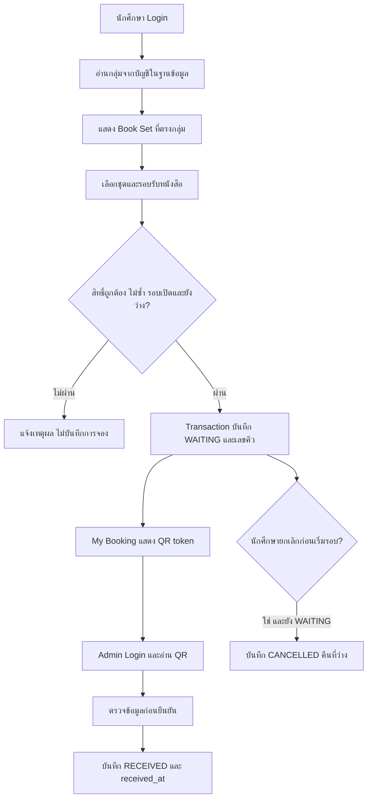
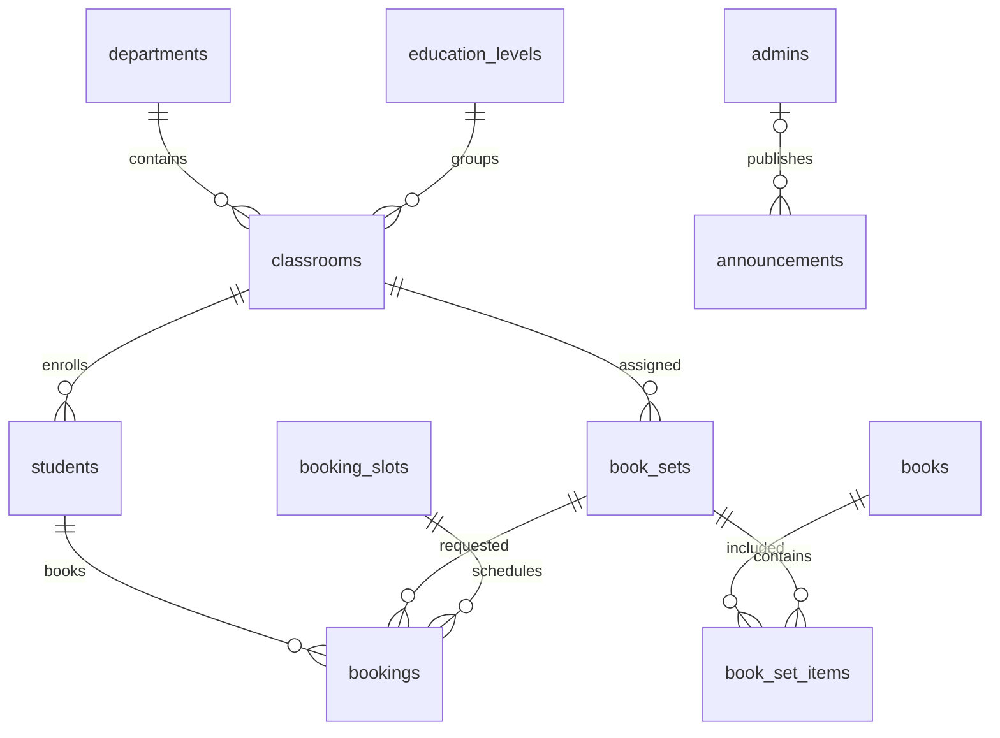

# เอกสารสรุปโครงงานฉบับสมบูรณ์ — Phase 18

ระบบจองคิวรับหนังสือออนไลน์สำหรับนักศึกษา (College Book Pickup Queue Booking System)

จัดทำสำหรับโครงงานระดับ ปวส. อ้างอิงโค้ดที่ส่งมอบหลัง Phase 17 และ schema ปัจจุบัน ณ 19 กันยายน 2569 เอกสารนี้เป็นสถานะปัจจุบัน ส่วนเอกสารแต่ละ Phase เป็นประวัติการพัฒนา ปรับปรุงเพิ่มเติม Feature 1 วันที่ 21 กันยายน 2569 รุ่น 18.1.0: เพิ่ม/แก้ไขนักศึกษาและนำเข้า CSV ดู FEATURE-1.md สำหรับคู่มือล่าสุด Feature 2 เสร็จแล้ว รุ่นปัจจุบัน 18.2.0 ดู FEATURE-2.md สำหรับเปลี่ยน/รีเซ็ตรหัสผ่าน

## 1. Project Overview — ภาพรวมโครงงาน

เว็บแอปพลิเคชันสำหรับให้นักศึกษาตรวจชุดหนังสือที่วิทยาลัยจัดให้ จองรอบวันและเวลารับหนังสือ และแสดง QR Code ให้เจ้าหน้าที่ตรวจสอบก่อนยืนยันรับ ชุดหนังสือผูกกับสาขาวิชา ระดับชั้น ห้องเรียน ภาคเรียน และปีการศึกษา ระบบใช้ฐานข้อมูล MySQL และแยกการเข้าสู่ระบบนักศึกษาออกจากเจ้าหน้าที่

นักศึกษาเปิดผ่านหน้า Login ส่วนเจ้าหน้าที่จัดการหนังสือ ชุดหนังสือ รอบรับ ประกาศ และตรวจรายงานผ่านหน้า Admin ระบบออกแบบหน้าจอให้ปรับตามขนาด Desktop, Tablet และ Mobile แต่การเชื่อมต่อของรุ่นปัจจุบันจำกัด localhost บนเครื่องที่รันเซิร์ฟเวอร์

## 2. Objective — วัตถุประสงค์

- ให้นักศึกษานัดหมายรับหนังสือตามรอบที่มีความจุชัดเจน
- แสดงหนังสือให้ตรงกับกลุ่มนักศึกษาจากบัญชีที่เข้าสู่ระบบ
- ป้องกันการจองชุดเดิมซ้ำและการจองเกินจำนวนที่รับได้
- ใช้ QR Code ค้นหารายการและบันทึกการรับหนังสือโดยเจ้าหน้าที่
- ให้เจ้าหน้าที่ตรวจยอด รายชื่อ และส่งออก CSV เพื่อประกอบการปฏิบัติงาน

## 3. Problem Statement — ที่มาและปัญหา

โครงงานตั้งอยู่บนปัญหาที่อาจเกิดจากการให้นักศึกษามารับหนังสือพร้อมกัน ได้แก่ ความแออัด การรอคอย การตรวจรายการหนังสือด้วยมือ และความยากในการตรวจว่าใครรับแล้วหรือยัง ระบบจึงเสนอการจองรอบและบันทึกสถานะไว้ในฐานข้อมูลเดียวกัน

ข้อความนี้เป็นเหตุผลในการออกแบบ ไม่ใช่ผลสำรวจของวิทยาลัย ยังไม่มีข้อมูลวัดว่าระยะเวลารอหรือภาระงานลดลงเท่าใด หากนำไปเขียนรายงานวิจัยควรเก็บข้อมูลก่อนและหลังใช้งานจริงเพิ่มเติม

## 4. Scope — ขอบเขตและข้อจำกัด

ครอบคลุม Phase 1–9 และ 11–18 ตาม [ขอบเขตที่ปรับปรุง](PROJECT-SCOPE.md) **Phase 10 ถูกยกเลิกทั้งหมด** ไม่มี Queue Display, หน้าทีวี/มอนิเตอร์, Now Serving, Next Queue หรือหน้าจอเรียกคิวสาธารณะ

นักศึกษาจองได้หนึ่งรายการที่ไม่ยกเลิกต่อ Book Set ไม่ใช่หนึ่งรายการตลอดชีวิตบัญชี เมื่อยกเลิกตามเงื่อนไขจึงจองชุดเดิมใหม่ได้ รอบรับเป็นรอบร่วม ไม่แยกช่องบริการหรือสาขา เลขคิวไม่ซ้ำภายในรอบ แต่เลขเดียวกันปรากฏในคนละรอบได้

ข้อจำกัดปัจจุบัน:

- Admin Students เพิ่ม/แก้ไขบัญชีและกลุ่มเรียน รวมทั้งนำเข้า CSV ได้ นักศึกษาไม่มีหน้าสมัครสมาชิกเอง บัญชีที่มีประวัติจองเปลี่ยนรหัสหรือกลุ่มไม่ได้
- เปลี่ยนรหัสของตนเองได้ทั้ง Student/Admin และ Admin รีเซ็ตรหัสนักศึกษาได้ ยังไม่มีกู้ผ่านอีเมลหรือรีเซ็ต Admin คนอื่น การเพิ่มบัญชีเริ่มต้นใช้ script และนักศึกษาเพิ่มเติมเตรียมผ่าน Admin Students ได้
- รองรับสถานะ CHECKED_IN และ NO_SHOW ในฐานข้อมูลและรายงาน แต่ไม่มีขั้นตอนหน้าเว็บตั้งสองสถานะนี้ และไม่เปลี่ยนเป็น NO_SHOW อัตโนมัติเมื่อเลยเวลา
- ยืนยันรับผ่าน Admin Scanner; Dashboard/Bookings ใช้ดู ค้น กรอง และเปิดรายละเอียด ไม่ใช่เครื่องมือแก้สถานะใดก็ได้
- ประกาศเพิ่มและอ่านได้ ยังไม่มีฟังก์ชันแก้ไขหรือลบประกาศ
- ส่งออก CSV เปิดนำเข้าใน Excel ได้ ไม่มีไฟล์ .xlsx โดยตรง
- Session เก็บในหน่วยความจำ เมื่อเริ่มเซิร์ฟเวอร์ใหม่ต้อง Login ใหม่
- ยังไม่รองรับการเปิดจากโทรศัพท์เครื่องอื่นผ่าน IP ของเครื่องเซิร์ฟเวอร์ และยังไม่ใช่ระบบ production ที่เผยแพร่สู่สาธารณะ

## 5. User Role — บทบาทผู้ใช้งาน

| บทบาท | สิทธิ์ |
|---|---|
| Student | Login/Logout เปลี่ยนรหัสตนเอง ดู Profile ชุดหนังสือ ประกาศ รอบรับ จอง ดูรายการและ QR ของตน ยกเลิกตามเงื่อนไข |
| Admin | Login/Logout เปลี่ยนรหัสตนเอง รีเซ็ตรหัสนักศึกษา เพิ่ม/แก้ไข/นำเข้าและดูรายชื่อนักศึกษา จัดหนังสือ/ชุด/รอบ สแกนและยืนยันรับ ดู Dashboard/Bookings ค้นกรอง รายงาน CSV และเพิ่มประกาศ |

ระบบตรวจสิทธิ์ที่ API และหน้าที่ต้อง Login นักศึกษาไม่สามารถใช้ Student session เรียก Admin API และไม่สามารถส่ง student_id หรือข้อมูลกลุ่มเพื่อจองแทนผู้อื่นได้

## 6. Feature — ความสามารถและคู่มือใช้งาน

### นักศึกษา

1. เปิด `http://localhost:3000/` กรอกรหัสนักศึกษาและรหัสผ่าน
2. ตรวจชื่อ/สาขา/ระดับ/ห้องที่ Profile หากผิดให้แจ้งผู้ดูแล ไม่สามารถเลือกกลุ่มใหม่เอง
3. ดูประกาศล่าสุดและชุดหนังสือใน Home หรือ Book List ชุดที่แสดงตรงกลุ่มบัญชี รวมภาคเรียนและปีที่มีข้อมูล
4. กดจอง เลือกชุดและรอบที่เปิดในอนาคต ตรวจวันเวลาแล้วกดยืนยัน
5. เปิด My Booking เพื่อดูเลขคิว วันเวลา หนังสือ สถานะ และ QR หรือบันทึกภาพ PNG
6. นำ QR พร้อมหลักฐานนักศึกษามาแสดงให้เจ้าหน้าที่ตามนัด
7. หากต้องการยกเลิก ทำได้เฉพาะ WAITING และก่อนเวลาเริ่มรอบ รายการเก่ายังคงเป็นประวัติ CANCELLED

### เจ้าหน้าที่

1. เปิด `http://localhost:3000/admin-login.html` แล้ว Login
2. เปิด Students เพื่อตรวจหรือเพิ่มนักศึกษา เลือกกลุ่มเรียน ตั้งรหัสเริ่มต้น หรือเลือก CSV เพื่อตรวจทุกแถวก่อนยืนยันนำเข้า ดู FEATURE-1.md
3. เปิด Books เพิ่มหนังสือ จากนั้น Book Sets เลือกสาขา ระดับ ห้อง ภาคเรียน ปีการศึกษา และหนังสือหลายเล่ม
4. เปิด Booking Slots สร้างวัน เวลา ความจุ และสถานะ OPEN โดยเลือกรอบอนาคต
5. เปิด Announcements เพิ่มข้อความแจ้งนักศึกษา ประกาศล่าสุดแสดงเมื่อโหลด Home
6. เมื่อรับหนังสือ เปิด Admin Scanner ใช้กล้องหรือเลือกภาพ QR ตรวจข้อมูลนักศึกษาและหนังสือ แล้วกดยืนยันรับ
7. Dashboard/Bookings ใช้ดูยอดและรายชื่อพร้อมตัวกรอง Reports ใช้เลือกประเภทและดาวน์โหลด CSV

หนังสือที่ถูกใช้ในชุดลบไม่ได้ ชุดที่มีประวัติจองแก้หรือลบไม่ได้ รอบที่มีประวัติจองลบหรือเปลี่ยนวันเวลาไม่ได้ ลดความจุต่ำกว่าจำนวนจองไม่ได้ ป้องกันการทำให้ประวัติไม่ตรงกับข้อมูลเดิม

## 7. System Flow — การทำงานของระบบ



การจองใช้ transaction และล็อกข้อมูลเพื่อตรวจที่ว่างซ้ำบนเซิร์ฟเวอร์ พร้อม Unique Key ในฐานข้อมูลป้องกันจองซ้ำ การนับจำนวนจองใช้รายการที่สถานะไม่ใช่ CANCELLED จึงไม่ต้องมีตัวนับที่นั่งแยก เมื่อเกิดข้อผิดพลาด transaction จะ rollback

QR เก็บ token สุ่มรูปแบบ BQ1 ตามด้วยข้อมูล token ไม่ใส่ข้อมูลส่วนบุคคลทั้งหมดลงในภาพ การอ่าน QR ยังไม่ถือว่ารับหนังสือ ต้องกดยืนยันก่อน การยืนยันซ้ำไม่เปลี่ยนเวลาและแจ้ง “รายการนี้รับหนังสือแล้ว”

สถานะที่เปลี่ยนผ่านหน้าเว็บ: สร้างเป็น WAITING, นักศึกษายกเลิก WAITING เป็น CANCELLED ก่อนเริ่มรอบ, เจ้าหน้าที่ยืนยันรายการที่รับได้เป็น RECEIVED รายงานอ่านสถานะที่บันทึกจริง ไม่อนุมานจากวันที่ย้อนหลัง

## 8. Database Structure — โครงสร้างฐานข้อมูล

ใช้ MySQL, InnoDB และ utf8mb4 มี **11 ตาราง** SQL ต้นฉบับอยู่ที่ [database/schema.sql](database/schema.sql) และรายละเอียดทุกคอลัมน์อยู่ที่ [พจนานุกรมข้อมูลฉบับปัจจุบัน](database/FINAL-DATA-DICTIONARY.md)

| ตาราง | Primary Key | หน้าที่ / Foreign Key |
|---|---|---|
| departments | department_id | สาขาวิชา |
| education_levels | education_level_id | ระดับชั้น |
| classrooms | classroom_id | ห้อง อ้างสาขาและระดับ |
| students | student_id | นักศึกษา อ้างห้องพร้อมสาขาและระดับด้วย composite FK |
| books | book_id | รหัส ชื่อ และคำอธิบายหนังสือ |
| book_sets | book_set_id | ชุดต่อกลุ่ม/ภาคเรียน/ปี อ้างห้องด้วย composite FK |
| book_set_items | id | ตารางเชื่อมชุดกับหนังสือ |
| booking_slots | slot_id | วัน เวลา ความจุ และ OPEN/CLOSED |
| bookings | booking_id | นักศึกษา ชุด รอบ เลขคิว QR สถานะ เวลา อ้าง students/book_sets/booking_slots |
| admins | admin_id | บัญชีเจ้าหน้าที่ |
| announcements | announcement_id | ประกาศ อ้าง admins ผ่าน created_by ซึ่งเป็น NULL ได้ |

ทุก PK เป็น INT UNSIGNED AUTO_INCREMENT รหัสผ่านเก็บ hash ไม่ใช่ข้อความรหัสจริง ความสัมพันธ์หลักใช้ ON DELETE RESTRICT ยกเว้น announcements.created_by ใช้ SET NULL เมื่อผู้สร้างถูกลบ

คีย์สำคัญ: student_code, username และ book_code ไม่ซ้ำ; book_sets ไม่ซ้ำกลุ่ม/ภาคเรียน/ปี; book_set_items ไม่ซ้ำชุด/หนังสือ; bookings ไม่ซ้ำ slot_id/queue_number และ qr_code ส่วน `(student_id, book_set_id, booking_guard)` ป้องกันสิทธิ์จองซ้ำ โดย booking_guard เป็น generated column: CANCELLED ให้ NULL สถานะอื่นให้ 1 ห้ามส่งค่าเอง

academic_year เก็บปี พ.ศ. ส่วน booking_date เก็บ ค.ศ. เวลาใช้งานเป็น Asia/Bangkok (+07:00) received_at ว่างจนกว่าจะยืนยันรับ

## 9. ER Diagram — ความสัมพันธ์ข้อมูล



หนึ่งห้องมีนักศึกษาและชุดหนังสือได้หลายรายการ หนังสือกับชุดเป็นหลายต่อหลายผ่าน book_set_items นักศึกษา ชุด และรอบมีประวัติจองได้หลายรายการ แต่แต่ละ booking ต้องมีนักศึกษา ชุด และรอบอย่างละหนึ่ง ส่วนประกาศอาจไม่มีผู้สร้างอ้างอิงหากบัญชีถูกลบไปแล้ว

students และ book_sets อ้าง `(classroom_id, department_id, education_level_id)` ร่วมกัน จึงบันทึกห้องกับสาขาหรือระดับที่ไม่สอดคล้องกันไม่ได้

## 10. Use Case — กรณีใช้งาน

| รหัส / ผู้ใช้ | เงื่อนไขเริ่มต้น | ขั้นตอนหลัก | ผลสำเร็จ / ทางเลือก |
|---|---|---|---|
| UC01 ทั้งสองบทบาท: Login | มีบัญชีในฐาน | กรอกชื่อผู้ใช้และรหัส | ได้ session ตามบทบาท; ผิดแจ้งเตือน; มากเกินกำหนดถูกจำกัด |
| UC02 Student: ดูหนังสือ | Login | เปิด Book List | เห็นชุดตรงกลุ่ม; ไม่มีชุดแจ้งว่าง |
| UC03 Student: จอง | มีชุดและรอบอนาคต | เลือกชุด/รอบ ยืนยัน | WAITING พร้อมเลขคิว; ซ้ำ/เต็ม/ผิดกลุ่มถูกปฏิเสธ |
| UC04 Student: แสดง QR | มีรายการของตน | เปิด My Booking | อ่าน/บันทึก QR; ไม่เปิดเผยรายการผู้อื่น |
| UC05 Student: ยกเลิก | WAITING ก่อนเริ่มรอบ | กดยกเลิกและยืนยัน | CANCELLED คืนที่ว่าง; พ้นเวลาหรือรับแล้วไม่ได้ |
| UC06 Admin: เตรียมข้อมูล | Login Admin | จัดหนังสือ ชุด และรอบ | บันทึกข้อมูลที่ผ่าน validation; ชน FK/ประวัติถูกปฏิเสธ |
| UC07 Admin: รับหนังสือ | QR ของรายการที่รับได้ | อ่าน QR ตรวจรายละเอียด ยืนยัน | RECEIVED และเวลารับ; รับซ้ำถูกปฏิเสธ |
| UC08 Admin: ตรวจและรายงาน | Login Admin | เลือกตัวกรอง ดูรายละเอียด ส่งออก | รายชื่อและ CSV ตรงเงื่อนไข; ไม่มีข้อมูลแสดงรายการว่าง |
| UC09 Admin: ประกาศ | Login Admin | กรอกหัวข้อ/เนื้อหา ส่ง | บันทึกประกาศ นักศึกษาเห็นล่าสุดเมื่อโหลดหน้า |
| UC10 ทั้งสองบทบาท: Logout | มี session | กดออกจากระบบ | session ถูกเพิกถอน ต้อง Login ใหม่ |

## 11. Technology — เทคโนโลยีและโครงสร้างโปรแกรม

| ส่วน | สิ่งที่ใช้จริง |
|---|---|
| Frontend | HTML, CSS, JavaScript ไม่มี React/Next.js |
| Backend | Node.js built-in HTTP server ไม่ได้ใช้ Express |
| Database driver | mysql2 และ parameterized queries |
| Authentication | scrypt, cookie HttpOnly/SameSite=Strict, session ในหน่วยความจำแยกบทบาท |
| QR | qrcode สร้างภาพ, jsQR อ่านภาพ |
| Testing | node:test, HTTP, MySQL แยกฐานสุ่ม, pngjs สำหรับตรวจภาพ |

```text
book-queue/
  backend/          HTTP server, authentication และกฎธุรกิจ
    scripts/        seed บัญชี และ migration
    tests/          unit, API, integration และ UI tests
  frontend/         หน้า HTML นักศึกษาและเจ้าหน้าที่
    assets/         CSS, JavaScript และ QR decoder
  database/         schema, diagram, dictionary และ SQL tests
  package.json      คำสั่งรันและ dependency
  package-lock.json dependency versions
  .env.example      ตัวอย่าง config ไม่มีรหัสจริง
  README.md         จุดเริ่มต้นอ่านคู่มือ
```

server.js ประกอบโมดูลและตรวจเส้นทาง ส่วนไฟล์ชื่อ `*-api.js` รับ HTTP และตรวจสิทธิ์ โมดูล bookings.js, catalog.js, slots.js และ pickup.js จัดกฎงานกับฐานข้อมูล รายละเอียด API เดิมมี Method, Input, Output และหน้าที่ตามคู่มือเหล่านี้:

| กลุ่ม API | คู่มือ |
|---|---|
| Student Login/Profile/Logout | [API Phase 3](API-PHASE-3.md) |
| Admin Login, Books, Book Sets, Lookups | [API Phase 4](API-PHASE-4.md) |
| Booking Slots | [API Phase 5](API-PHASE-5.md) |
| Booking | [API Phase 6](API-PHASE-6.md) |
| QR PNG | [API Phase 7](API-PHASE-7.md) |
| Pickup | [API Phase 8](API-PHASE-8.md) |
| My Booking / Cancellation | [API Phase 9](API-PHASE-9.md) |
| Dashboard / Bookings | [API Phase 11](API-PHASE-11.md), [ตัวกรอง Phase 12](API-PHASE-12.md) |
| Reports / CSV | [API Phase 13](API-PHASE-13.md) |
| Announcements | [API Phase 14](API-PHASE-14.md) |
| Validation/Security ที่ใช้ร่วมกับ API ก่อนหน้า | [API Phase 15](API-PHASE-15.md) |
| Password management | [API Feature 2](API-FEATURE-2.md) |
| Students | [API Phase 16](API-PHASE-16.md), [API Feature 1](API-FEATURE-1.md) |

Phase 18 ไม่เพิ่ม API รายละเอียดข้อจำกัดความปลอดภัยอยู่ใน [SECURITY-REVIEW.md](SECURITY-REVIEW.md)

## 12. Installation — การติดตั้ง

### เครื่องเดิมที่ทำ Phase 17 แล้ว

ใช้โฟลเดอร์และ .env เดิม ไม่ต้อง import schema, seed หรือ migrate ซ้ำ Phase นี้เป็นเอกสาร อ่านวิธีรันในหัวข้อ 13 ได้เลย

### เครื่องใหม่ / ฐานใหม่เท่านั้น

เตรียม Node.js ตาม engines ของโปรเจกต์ (>=22 และต้องรองรับ process.loadEnvFile; เครื่องทดสอบใช้ Node 24), npm และ MySQL ที่รองรับ CHECK constraints ตาม schema (8.0.16 ขึ้นไป; เครื่องทดสอบใช้ MySQL 26.7) คำแนะนำนี้เป็นข้อกำหนดของโปรเจกต์ ไม่ใช่คำแนะนำรุ่นล่าสุดจากผู้ผลิต

1. แตก ZIP แล้วเปิด PowerShell ในโฟลเดอร์ที่มี package.json ตรวจด้วย `Get-Location` และ `Test-Path package.json`
2. ติดตั้ง dependency และสร้าง config **เฉพาะเมื่อยังไม่มี .env**:

```powershell
npm ci
if (!(Test-Path .env)) { Copy-Item .env.example .env }
notepad .env
```

ตัวอย่าง config ให้แทนรหัสตัวอย่างด้วยค่าที่ตั้งเอง อย่านำข้อความตัวอย่างไปใช้เป็นรหัสจริง:

```dotenv
PORT=3000
DB_HOST=127.0.0.1
DB_PORT=3306
DB_USER=root
DB_PASSWORD="ใส่รหัส MySQL ของคุณ"
DB_NAME=college_book_queue
SESSION_MINUTES=60
DEMO_STUDENT_PASSWORD="ตั้งรหัสนักศึกษาอย่างน้อย12ตัว"
ADMIN_USERNAME=admin
ADMIN_PASSWORD="ตั้งรหัสเจ้าหน้าที่ของคุณ"
```

เครื่องหมายคำพูดครอบค่าเก็บไว้ได้ seed นักศึกษารับ 12–128 ตัวอักษร ส่วน seed Admin ในโค้ดปัจจุบันรับ 6–128 ตัวอักษร การแก้ค่าใน .env ไม่เปลี่ยนรหัสของบัญชีที่มีอยู่แล้ว และ seed ไม่เขียนทับบัญชีเดิม

3. เชื่อม MySQL จาก PowerShell เปลี่ยนตำแหน่ง mysql.exe ตามเครื่อง หากใช้ตำแหน่งที่เจ้าของโปรเจกต์ระบุ:

```powershell
& "C:\Program Files\MySQL\MySQL Server 26.7\bin\mysql.exe" -h 127.0.0.1 -P 3306 -u root -p --default-character-set=utf8mb4
```

กรอกรหัส root เมื่อถูกถาม หน้าจอไม่แสดงตัวอักษร เมื่อเห็น `mysql>` จึงพิมพ์ SQL ต่อไปนี้ ชื่อฐานต้องยังไม่ถูกใช้งาน ถ้ามีฐานเดิมให้หยุดและเลือกชื่อฐานใหม่พร้อมแก้ DB_NAME ให้ตรง:

```sql
CREATE DATABASE college_book_queue CHARACTER SET utf8mb4 COLLATE utf8mb4_unicode_ci;
USE college_book_queue;
```

นำเข้า schema ด้วย `source` ใน MySQL prompt ตัวอย่างตำแหน่งของเครื่องพัฒนา (เครื่องอื่นเปลี่ยนเป็นตำแหน่งที่แตก ZIP และใช้ /):

```sql
source C:/Users/KSD/Documents/Codex/2026-09-11/files-pasted-by-the-user-web/outputs/book-queue/database/schema.sql
SHOW TABLES;
exit;
```

ต้องพบ 11 ตาราง ไม่มี error ระหว่าง import schema ปัจจุบันมี received_at และ announcements แล้ว จึงไม่ต้องรัน migration Phase 8/14 บนฐานใหม่ ห้ามใช้ database/tests.sql เตรียมข้อมูลฐานใช้งานจริง

4. กลับมาที่ PowerShell โฟลเดอร์โปรเจกต์ สร้างบัญชีเริ่มต้น:

```powershell
npm run seed:student
npm run seed:admin
```

seed:student สร้างรหัส 66309010001 กลุ่มเทคโนโลยีสารสนเทศ ปวส.2 ห้อง ปวส.2/1 ใช้รหัสที่ตั้งใน DEMO_STUDENT_PASSWORD ส่วน Admin ใช้ ADMIN_USERNAME และ ADMIN_PASSWORD script ไม่สร้าง Book Set, หนังสือ หรือรอบ ให้ Login Admin แล้วเตรียมผ่านหน้าเว็บ

ไม่ได้ seed นักศึกษาต่างสาขาให้อัตโนมัติบนฐานใช้งานจริง สามารถเพิ่มหรือนำเข้า CSV ผ่าน Admin Students ของ Feature 1 ได้ กรณีทดสอบสองสาขาแบบอัตโนมัติสร้างบัญชีเฉพาะในฐานทดสอบและล้างหลังจบ

## 13. How to Run — วิธีรันและแก้ปัญหาเบื้องต้น

เปิด PowerShell ในโฟลเดอร์ที่มี package.json:

```powershell
npm start
```

ปล่อย Terminal นี้เปิดไว้ เข้า `http://localhost:3000/` สำหรับนักศึกษา หรือ `http://localhost:3000/admin-login.html` สำหรับเจ้าหน้าที่ หากเปลี่ยน PORT ให้เปลี่ยน URL ให้ตรง หยุดด้วย Ctrl+C แล้วรันใหม่หลังแก้ .env

| อาการ | วิธีตรวจ |
|---|---|
| เว็บเปิดไม่ได้ | ตรวจว่า npm start ยังรันอยู่ อ่าน error ใน Terminal และใช้ port ที่ตั้งจริง |
| EADDRINUSE | มีโปรแกรมหรือ server เดิมใช้ port อยู่ หยุดตัวเดิมที่รู้จัก หรือเปลี่ยน PORT |
| MySQL พอร์ต 3306 ถูกใช้ | อาจมี MySQL เดิมทำงานอยู่ ตรวจ service ก่อนติดตั้งเพิ่ม |
| cannot find path | ใช้ตำแหน่ง mysql.exe ที่ติดตั้งจริง ไม่คัดลอกเลขรุ่นของเครื่องอื่น |
| Access denied / DB ไม่พร้อม | ตรวจ MySQL service, host, port, user, password และชื่อฐานใน .env |
| Login ผิดหลังแก้ .env | บัญชีเดิมใช้ hash เดิม seed/config ไม่ใช่การ reset รหัสผ่าน |
| ไม่เห็นชุดหนังสือ | ต้องมีชุดตรงสาขา ระดับ ห้องของบัญชี และมีรายการหนังสือในชุด |
| ไม่มีรอบให้จอง | สร้างรอบอนาคต OPEN และยังมีที่ว่าง |
| กล้องใช้ไม่ได้ | ตรวจสิทธิ์กล้องและอุปกรณ์ หรือใช้ปุ่มเลือกภาพ QR ที่ระบบมี |

อย่าเปิดไฟล์ HTML ด้วย file:// เพราะต้องใช้ server และ session เดียวกับ API อย่าแจก .env ที่มีรหัสจริงไปพร้อมโครงงาน

## 14. Test Case — การทดสอบ

ผลล่าสุด Feature 2 ดู [TEST-RESULTS-FEATURE-2.md](TEST-RESULTS-FEATURE-2.md)

ผลเพิ่มเติม Feature 1 ดู [TEST-RESULTS-FEATURE-1.md](TEST-RESULTS-FEATURE-1.md)

หลักฐานก่อน Phase 18: วันที่ 19 กันยายน 2569 Phase 17 ผ่าน **192 tests, fail 0, skipped 0** บน MySQL จริง ดู [ผลทดสอบฉบับเต็ม](TEST-RESULTS-PHASE-17.md) และ [ชุดทดสอบ](backend/tests/phase17.mysql.test.js) ผลนี้ไม่ใช่ข้ออ้างว่าทุกอุปกรณ์หรือทุกโหลดผู้ใช้ผ่านแล้ว

เตรียมชุดทดสอบสองสาขาและรอบความจุ 1 สำหรับตรวจด้วยมือ ใช้ข้อมูลทดสอบแยกจากข้อมูลจริง เลือกวันอนาคตทุกครั้ง:

| กรณี | ขั้นตอน | ผลที่คาดหวัง | หลักฐาน Phase 17 |
|---|---|---|---|
| T01 รับหนังสือครบวงจร | Student Login → หนังสือ → จอง → QR → Admin อ่านภาพ → ยืนยัน | WAITING เปลี่ยน RECEIVED มี received_at และ My Booking ตรงกัน | HTTP/MySQL/ภาพ QR และ browser ผ่าน |
| T02 จองซ้ำ | บัญชีเดิมเลือกชุดเดิมอีกรอบ | 409 ไม่มีรายการหรือจำนวนจองเพิ่ม | ผ่าน |
| T03 รอบเต็ม | คนแรกจองรอบ 1 ที่ คนอื่นลองจอง | 409 คิวเต็ม ไม่บันทึกเพิ่ม | ผ่าน |
| T04 ยกเลิก | ยกเลิก WAITING ก่อนเริ่มรอบ แล้วลองซ้ำ | คืนที่ว่าง 1 ครั้ง รายการ CANCELLED; ซ้ำ 409; จองใหม่ได้ | ผ่าน |
| T05 รับซ้ำ | อ่าน QR ที่ RECEIVED แล้วยืนยันซ้ำ | แจ้งรับแล้ว ปุ่ม disabled ไม่แก้ received_at | HTTP และ browser ผ่าน |
| T06 คนละสาขา | Login บัญชี IT/บัญชี และลองส่งชุดอีกกลุ่ม | เห็นเฉพาะชุดตน ปลอมชุดอีกกลุ่มได้ 403 | ผ่าน |
| T07 สิทธิ์ | Logout แล้วเข้าหน้าส่วนตัว/API หรือใช้ Student เข้า Admin | ขอ Login / API ปฏิเสธตามบทบาท | regression ผ่าน |
| T08 รายงาน | กรอง RECEIVED แล้วดาวน์โหลด CSV | รายชื่อและจำนวนตรงฐานและตัวกรอง | ผ่าน |

รันอัตโนมัติใน PowerShell โฟลเดอร์โปรเจกต์ บัญชี DB ต้องสร้างและลบฐานทดสอบได้:

```powershell
$env:RUN_MYSQL_TESTS='1'
try { npm test } finally { Remove-Item Env:RUN_MYSQL_TESTS -ErrorAction SilentlyContinue }
```

ทดสอบเฉพาะหก Scenario:

```powershell
$env:RUN_MYSQL_TESTS='1'
try { node --test backend/tests/phase17.mysql.test.js } finally { Remove-Item Env:RUN_MYSQL_TESTS -ErrorAction SilentlyContinue }
```

tests สร้างฐานสุ่มแยกและล้างหลังจบ ไม่ต้องลบ bookings ในฐานใช้งานเพื่อรัน tests ถ้าไม่เปิด RUN_MYSQL_TESTS จะมี skipped จึงยังสรุปว่า MySQL ผ่านไม่ได้ กล้องจริงยังไม่ได้ทดลองในเครื่องนี้ การตรวจ browser ใช้ภาพ QR ส่วนการจัดการกล้องมี test จำลอง ยังไม่มี load test สำหรับ production

## 15. Future Development — แนวทางพัฒนาต่อ

ข้อเสนอต่อไปนี้ยังไม่ได้ทำและไม่ถือเป็นส่วนที่ส่งมอบ: การนำเข้าเพื่ออัปเดตบัญชีเดิมแบบมีประวัติการแก้, การกู้รหัสผ่านผ่านอีเมล, ขั้นตอน CHECKED_IN/NO_SHOW พร้อมประวัติผู้แก้, แจ้งเตือนก่อนถึงนัด, แก้ไข/ลบประกาศ, ส่งออก .xlsx, แยกช่องบริการ, persistent session, HTTPS และการปรับสำหรับใช้งานข้ามเครื่องพร้อมทดสอบโหลดและกล้องจริง

ควรเก็บข้อมูลเวลารอ ความผิดพลาด และความพึงพอใจหลังใช้งานเพื่อประเมินวัตถุประสงค์ ข้อเสนอเหล่านี้ต้องกำหนดขอบเขตและได้รับคำสั่งก่อนพัฒนา **ไม่มีข้อเสนอคืน Phase 10 หรือหน้าจอเรียกคิวสาธารณะ** และยังไม่มี Phase ถัดไปที่ได้รับอนุมัติ
