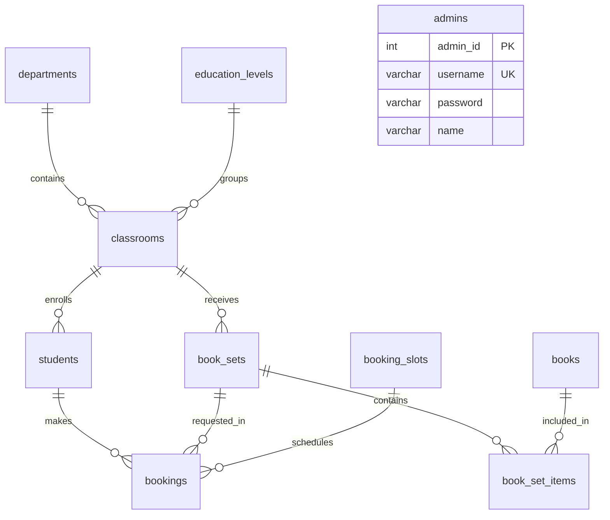
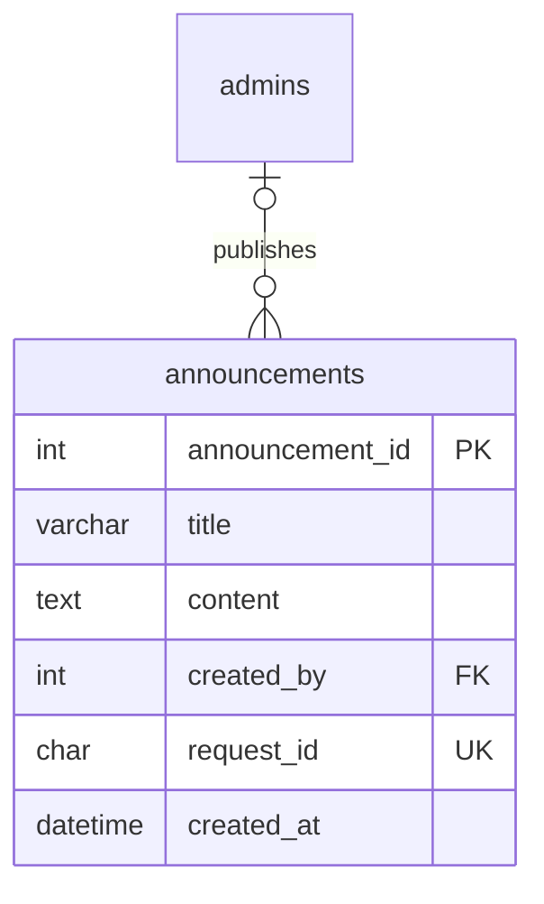

# ER Diagram และแนวทางออกแบบ — Phase 2

มี 10 ตาราง ใช้ InnoDB และ utf8mb4 รองรับภาษาไทย ทุกตารางมี Primary Key ชนิด INT UNSIGNED AUTO_INCREMENT ส่วน Foreign Key ใช้ชนิดเดียวกับคีย์ที่อ้างอิง

## ความสัมพันธ์แบบข้อความ

```text
departments (1) ─── (N) classrooms
education_levels (1) ─── (N) classrooms
classrooms (1) ─── (N) students
classrooms (1) ─── (N) book_sets
book_sets (1) ─── (N) book_set_items
books (1) ─── (N) book_set_items
students (1) ─── (N) bookings
book_sets (1) ─── (N) bookings
booking_slots (1) ─── (N) bookings
admins : บัญชีเจ้าหน้าที่ ยังไม่มีตารางกิจกรรมที่อ้างอิงใน Phase 2
```

N หมายถึงศูนย์รายการขึ้นไป เช่น ห้องอาจยังไม่มีนักศึกษา แต่รายการลูกแต่ละรายการต้องมีรายการแม่หนึ่งรายการเสมอ เพราะ Foreign Key เป็น NOT NULL

นักศึกษาหนึ่งคนมีประวัติจองหลายรายการได้ แต่มีรายการที่ไม่ยกเลิกได้เพียงหนึ่งรายการต่อ Book Set



## คีย์หลักและคีย์นอก

| ตาราง | Primary Key | Foreign Key |
| --- | --- | --- |
| departments | department_id | ไม่มี |
| education_levels | education_level_id | ไม่มี |
| classrooms | classroom_id | department_id → departments; education_level_id → education_levels |
| students | student_id | (classroom_id, department_id, education_level_id) → classrooms |
| books | book_id | ไม่มี |
| book_sets | book_set_id | (classroom_id, department_id, education_level_id) → classrooms |
| book_set_items | id | book_set_id → book_sets; book_id → books |
| booking_slots | slot_id | ไม่มี |
| bookings | booking_id | student_id → students; slot_id → booking_slots; book_set_id → book_sets |
| admins | admin_id | ไม่มี |

students และ book_sets เก็บ department_id, education_level_id, classroom_id ตามโจทย์ แต่ใช้ Foreign Key สามคอลัมน์ร่วมกัน หากห้องอยู่สาขาไอทีจะบันทึกสาขาเป็นบัญชีไม่ได้ ความสัมพันธ์ไป departments และ education_levels ได้รับการตรวจผ่าน classrooms อยู่แล้ว

## ป้องกันการจองซ้ำ

เพิ่มสองคอลัมน์ใน bookings:

1. book_set_id ระบุชุดหนังสือที่จะรับ ทำให้ทราบภาคเรียนและปีการศึกษาของการจอง
2. booking_guard เป็น generated column ที่ MySQL คำนวณเอง: CANCELLED → NULL; สถานะอื่น → 1 ห้ามส่งค่าเองจาก backend

Unique Key `(student_id, book_set_id, booking_guard)` อนุญาตเพียงหนึ่งรายการที่ไม่ยกเลิกต่อนักศึกษาและชุดเดียวกัน แม้เลือกคนละ slot_id การส่งคำสั่งพร้อมกันต้องผ่าน Unique Key นี้ ไม่ใช่อาศัย SELECT ตรวจล่วงหน้าเพียงอย่างเดียว

MySQL อนุญาต NULL หลายแถวใน Unique Key จึงเก็บประวัติยกเลิกหลายครั้งและมีรายการใหม่หนึ่งรายการร่วมกันได้ ดู [Unique indexes](https://dev.mysql.com/doc/refman/8.4/en/create-index.html) และ [generated columns](https://dev.mysql.com/doc/refman/8.4/en/create-table-generated-columns.html)

| สถานะ | booking_guard | จองชุดเดิมเพิ่ม |
| --- | --- | --- |
| WAITING | 1 | ไม่ได้ |
| CHECKED_IN | 1 | ไม่ได้ |
| RECEIVED | 1 | ไม่ได้ เพื่อป้องกันรับซ้ำ |
| CANCELLED | NULL | ได้ หากไม่มีรายการที่ไม่ยกเลิกอื่น |
| NO_SHOW | 1 | ไม่ได้โดยอัตโนมัติ รอเจ้าหน้าที่พิจารณา |

ถ้ามีรายการใหม่แล้ว การเปลี่ยนรายการเก่าที่ CANCELLED กลับเป็น WAITING จะถูก Unique Key ปฏิเสธด้วย

## ข้อกำหนดการออกแบบ

- Book Set มีหนึ่งชุดต่อสาขา + ระดับชั้น + ห้อง + ภาคเรียน + ปีการศึกษา ป้องกันสร้างชุดซ้ำเพื่อหลบกติกาจอง
- หนังสือและ Book Set เป็นหลายต่อหลายผ่าน book_set_items หนังสืออยู่ได้หลายชุด แต่ห้ามซ้ำในชุดเดียวกัน
- semester: 1 = ภาคเรียนแรก, 2 = ภาคเรียนที่สอง, 3 = ฤดูร้อน
- academic_year เก็บ พ.ศ. เช่น 2569; booking_date เก็บ DATE แบบ ค.ศ. เช่น 2026-09-15 แล้วแปลงตอนแสดงผล
- start_time/end_time เป็นเวลาท้องถิ่น Asia/Bangkok ภายในวันเดียว รอบข้ามเที่ยงคืนไม่อยู่ในแบบนี้
- created_at ใช้ DATETIME เก็บเวลา Asia/Bangkok; backend ต้องตั้ง session time_zone เป็น +07:00 เมื่อเริ่มเชื่อมต่อจริง
- Slot เป็นรอบร่วมของวิทยาลัย ยังไม่แยกช่องบริการหรือจำกัดสาขา
- เลขคิวห้ามซ้ำภายใน slot_id เดียวกัน รวม CANCELLED เพื่อไม่ใช้เลขเดิมซ้ำในรอบ เลข A001 อาจอยู่ในรอบอื่นได้ การค้นหาและเรียกคิวต้องมีบริบทวัน/รอบร่วมด้วย
- qr_code เก็บ token ไม่ซ้ำ เทียบตัวพิมพ์ตรงกัน ไม่เก็บภาพ QR หรือข้อมูลส่วนตัว เป็น NULL ได้ก่อน Phase 7
- password เก็บ hash ที่ backend สร้างเท่านั้น ขนาด 255 ตัวอักษร ยังไม่มีบัญชีเริ่มต้น ข้อกำหนด hash เป็นหน้าที่ backend; CHECK ไม่ได้พิสูจน์ว่าข้อความเป็น hash
- ทุก FK ใช้ RESTRICT เมื่อลบหรือแก้คีย์รายการแม่ เพื่อปกป้องข้อมูลที่ถูกอ้างอิง ไม่เปลี่ยน id หรือเปลี่ยนสาขาของห้องที่ถูกอ้างอิง ให้สร้างห้องใหม่ตามความเหมาะสม

## ขอบเขตที่ยังต้องทำใน Phase หลัง

ฐานข้อมูลตรวจการอ้างอิง ชนิดสถานะ ช่วงเวลา ความจุมากกว่าศูนย์ และจองซ้ำ แต่ยังไม่ใช่ระบบ Booking:

- Phase 3: Login ตรวจ hash และดึงข้อมูลจากบัญชี
- Phase 4/6: ตรวจว่า Book Set ตรงกลุ่มนักศึกษาที่ล็อกอินและเทอมที่ให้บริการ ห้ามเชื่อ student_id หรือกลุ่มจากเบราว์เซอร์ FK ใน bookings ตรวจเพียงว่าทั้งสองรายการมีอยู่ ยังไม่ตรวจกลุ่มข้ามตารางนี้
- Phase 4: ชุดต้องมีหนังสือก่อนเปิดจอง และไม่แก้หนังสือในชุดที่มีการจองแล้ว เพื่อคงประวัติ
- Phase 5/6: ตรวจวันย้อนหลัง รอบปิด เวลาทับซ้อนและจำนวนผู้จองเทียบ max_students ใน transaction โดยล็อก booking_slots ด้วย SELECT FOR UPDATE ก่อนนับและ INSERT ทุกช่องทางเขียนข้อมูลรวมการลดความจุต้องใช้กติกาเดียวกัน
- Phase 6: สร้างเลขคิวและจัดการ duplicate-key/deadlock
- Phase 8 เพิ่ม received_at (DATETIME NULL) และยืนยัน WAITING/CHECKED_IN → RECEIVED แล้ว ไม่มีความสัมพันธ์ FK ใหม่ Phase 9 เพิ่มการยกเลิก WAITING ก่อนเวลาเริ่มรอบ พร้อมคืนคิวโดยไม่นับ CANCELLED แล้ว ห้ามเปลี่ยน RECEIVED เป็น CANCELLED เพื่อเปิดสิทธิ์รับซ้ำ

ข้างต้นเป็นข้อกำหนดสำหรับ Phase หลัง ยังไม่ได้สร้าง API, trigger หรือขั้นตอนจองจริงใน Phase นี้


## Phase 14: ประกาศ



เมื่อ Admin ถูกลบ ประกาศยังอยู่ โดย created_by เป็น NULL
